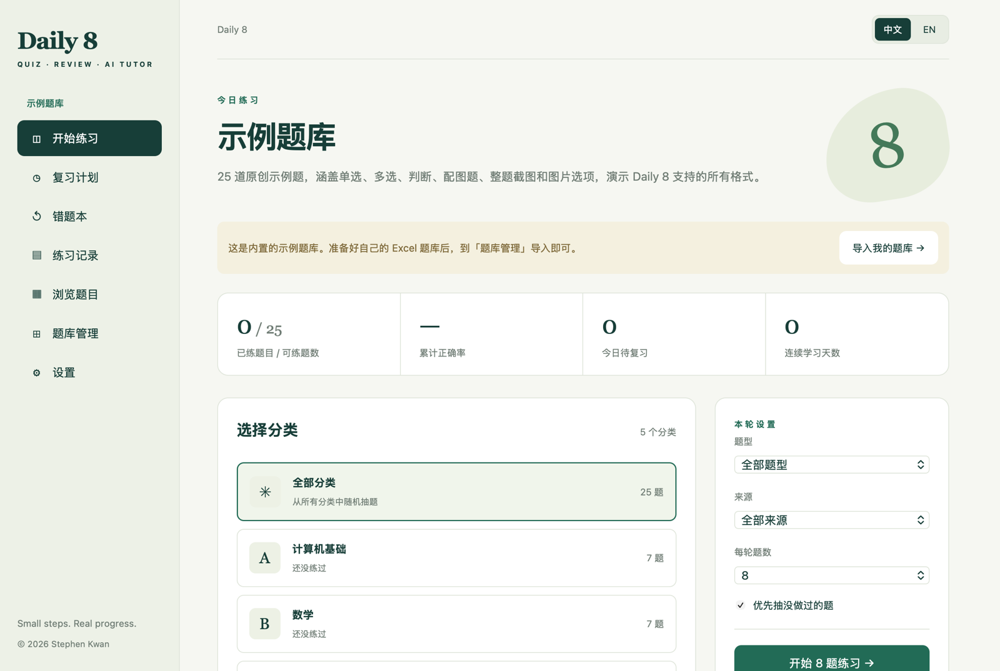
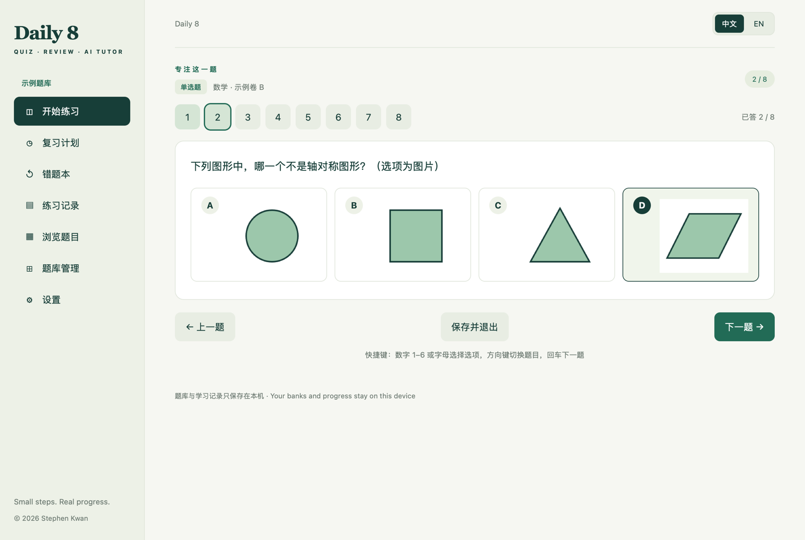
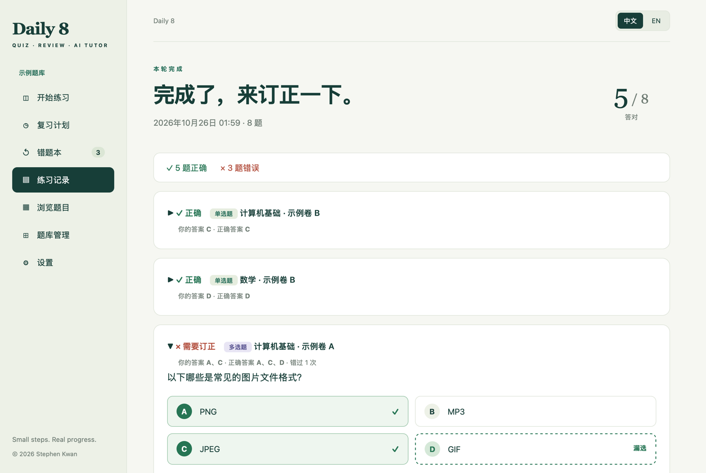
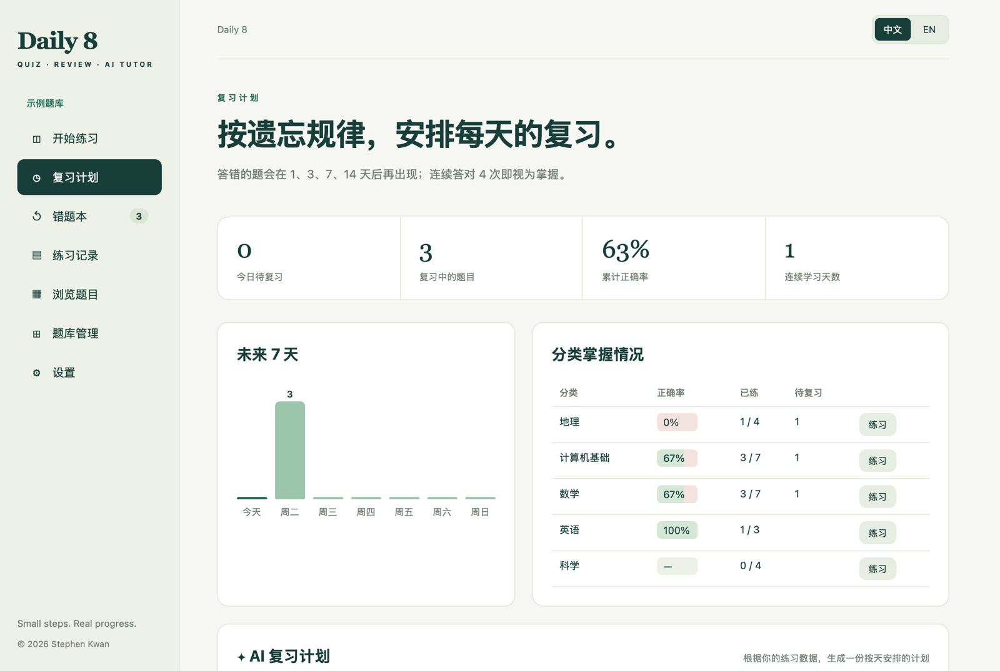

# Daily 8

**用 Excel 准备任何选择题题库，每天练一小轮，错题自动排进复习计划，还可以让 AI 讲解错题。**

有网页版和 macOS App 两种形式。题库和学习记录只保存在你自己的设备上。



| 练习（支持图片选项） | 订正 | 复习计划 |
|---|---|---|
|  |  |  |

## 功能

- **任何题库都能导入**：一行一道题的 Excel（或 CSV），支持单选、多选、判断，选项 2–6 个。题目可以是文字、文字加配图，或者整题截图；图片可以直接粘贴在 Excel 里。详见 [题库格式](docs/题库格式.md)。
- **一轮一小组**：按分类、题型、来源抽题，可以优先抽没做过的题。作答时不显示答案，提交后统一批改。多选题必须全部选对才算对。
- **错题本**：答错的题自动收进来，可以写错因笔记。
- **间隔复习**：错题在 1、3、7、14 天后再次出现，连续答对 4 次才算掌握。「复习计划」页面显示每天到期的题数和各分类的掌握情况。
- **AI 讲解与复习计划**（可选）：填入你自己的 OpenAI API Key（也可以接 DeepSeek、通义千问或中转服务等任何兼容 OpenAI 接口的服务），就能让 AI 讲解错题（支持识图的模型还能看懂题目里的图片），或者根据练习数据生成按天安排的复习计划。
- **多个题库**：可以导入多个题库随时切换，每个题库的学习记录分开保存。更新题库时，编号不变的题会保留学习记录。
- 中文 / English 界面，支持键盘快捷键，可以导出和恢复备份。

内置一个[示例题库](demo/demo.xlsx)，25 道原创题目，覆盖上面所有格式。

## 下载与使用

- **macOS**：从 [Releases](../../releases) 下载 `Daily-8-<版本>.dmg`，打开后把 Daily 8 拖进「应用程序」。支持 macOS 13 及以上，Apple Silicon 和 Intel 都可以用。
  这个 App 没有经过 Apple 公证，第一次打开时要**右键点击 App → 打开**。
- **网页版**：打开仓库的 GitHub Pages 地址即可使用（启用方法见下面的「发布」）。也可以下载 Releases 里的 `Daily-8.html`，双击就能离线使用。

### 导入自己的题库

1. 在「题库管理」下载空白模板，按 [题库格式](docs/题库格式.md) 填好题目和答案。
2. 有图片的话，把图片和表格放进同一个文件夹，压缩成 zip。
3. 在「题库管理」选择文件（或者直接拖进去），确认预览无误后导入。

### AI 讲解

在「设置 → AI 讲解」里填写三项：

| 设置 | 说明 |
|---|---|
| API Key | [OpenAI API Key](https://platform.openai.com/api-keys)，或者其他服务商提供的 Key。 |
| 接口地址 | 留空就是 OpenAI 官方（`https://api.openai.com/v1`）。用其他兼容服务时，填对方给的地址，通常以 `/v1` 结尾。 |
| 模型 | 默认 `gpt-5.5`。点「测试连接」会列出接口提供的所有模型，可以直接选。 |

用的是 OpenAI 的 Chat Completions 接口（流式输出），兼容服务基本都支持。所选模型不支持图片时，关掉「发送题目图片」即可，只发文字。

- 费用由服务商按用量直接向你收取；不用 AI 功能就不会产生费用。
- Key 只会发送给你填写的接口地址：Mac App 把它保存在钥匙串里，网页版保存在当前浏览器里（在公用电脑上用完请清除）。
- 请求 AI 讲解时，会把这道题的文字、图片和你的答案发送给服务商；生成复习计划时，发送的是各分类的统计数据和最近错题的摘要。
- 网页版直接从浏览器发出请求，接口需要允许跨域（OpenAI 官方支持；有些中转服务不支持，可以改用 Mac App）。Mac App 通过系统网络发送请求，没有这个限制。

## 数据保存在哪里

| | 题库 | 学习记录、设置 | API Key |
|---|---|---|---|
| macOS App | WebKit IndexedDB | `~/Library/Application Support/Daily 8/storage.json` | 钥匙串 |
| 网页版 | 浏览器的 IndexedDB | 浏览器的 localStorage | 浏览器的 localStorage |

换设备前，先在「设置」里导出学习记录；题库文件请自己保留一份，到新设备上重新导入即可。

## 开发

需要 Node 18 或以上、Python 3，以及 Xcode Command Line Tools（构建 Mac App 才需要）。

```sh
npm ci           # 安装开发依赖（openai SDK、fflate、esbuild）
make test        # 生成示例题库，然后运行测试
make web         # 生成 dist/index.html（单个文件，网页和 App 共用）
make dmg         # 生成 build/Daily 8.app 和 build/Daily-8-<版本>.dmg
make test-app    # 在真实的 App 里跑自检，含模拟 OpenAI 服务器的完整 AI 流程（使用独立的数据、WebKit 存储和钥匙串项目，不碰真实数据）
make vendor      # 升级依赖后，重新打包 src/vendor/
```

```
src/
  xlsx.js         读取 .xlsx / .csv，包括粘贴在表格里的图片
  bank.js         表格转题库、导入校验、IndexedDB 存储
  progress.js     批改、错题本、间隔复习、统计（纯函数）
  ai.js           AI 讲解和复习计划（openai SDK，Chat Completions 流式输出）
  app.js          页面与交互
  platform.js     存储、文件保存、对话框（区分网页和 App）
  i18n.js, i18n-en.js
  vendor/         打包好的 openai SDK 和 fflate
macos/            原生外壳（Swift + WKWebView）
demo/             示例题库、空白模板，以及生成配图的脚本
scripts/          构建和测试脚本
tests/            Node 测试
```

### 发布

- **网页版**：在仓库的 Settings → Pages 里，把 Source 设为「GitHub Actions」。之后每次推送到 `main`，都会运行测试并部署 `dist/`（`.github/workflows/pages.yml`）。
- **Mac App**：推送 `v1.0.0` 这样的标签，`.github/workflows/release.yml` 会在 macOS 上构建 DMG 和离线版 HTML，并上传到 Releases。要让别人双击就能打开，需要 Apple Developer ID：设置 `SIGN_IDENTITY` 后构建，再做公证。

## 关于题库内容

这个项目只是一个工具，不附带任何真实考试的题目。导入和分享题库前，请确认你有权使用其中的内容；有版权的试题请只在自己的设备上使用。

## 许可证

[MIT](LICENSE) © 2026 Stephen Kwan。许可证只适用于代码和原创示例题库，不适用于你自己导入的题库内容。

---

## English

**Daily 8** turns any multiple-choice question bank you prepare in Excel into short daily practice sessions, with a mistakes notebook, spaced review (1 / 3 / 7 / 14 days), and optional AI explanations and review plans using your own OpenAI API key — or any OpenAI-compatible endpoint (Chat Completions). It supports single choice, multiple choice and true/false; questions can be text, text with images, or full screenshots, and pictures can be pasted straight into the spreadsheet. It runs as a single-file web page or as a native macOS app (13+, universal), and everything stays on your device. MIT licensed. See [the bank format](docs/题库格式.md) (column names are accepted in English too: `question`, `A`–`F`, `answer`, `type`, `category`, `image`, `explanation`, `source`, `id`).
